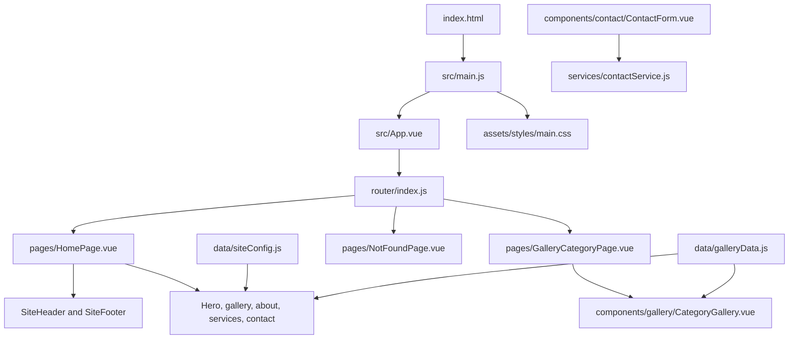
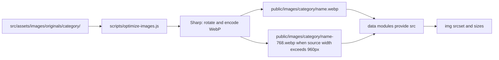

# Architecture

## Overview

This project is a client-rendered Vue 3 single-page application built with Vite. Vue Router handles the home page, category galleries, and not-found route. The site copy and gallery records are kept in JavaScript data modules, while photographs are served as static WebP assets.

## Application startup and routing

- `index.html` supplies the document metadata and the `#app` mount point.
- `src/main.js` loads the self-hosted fonts, shared styles, and router, then mounts the Vue application.
- `src/App.vue` provides the skip link, renders the active route with `RouterView`, and mounts Vercel Analytics in production builds.
- `src/router/index.js` defines `/`, `/gallery/:category`, and a catch-all not-found route. Its scroll behavior restores saved positions, scrolls to hash targets, and returns new pages to the top.
- `src/pages/` composes page-level layouts and updates document titles and descriptions for the active page.

Static hosts must rewrite unknown paths to `/index.html` for direct navigation to category routes to work.

## Components and data

`src/components/` is grouped by responsibility:

- `common/` contains shared elements such as section headings, photo banners, and scroll reveals.
- `layout/` contains the site header and footer.
- `home/` contains the home page sections.
- `gallery/` renders category navigation and photo collections.
- `contact/` contains the client-side contact form.

`src/data/siteConfig.js` stores the photographer profile, navigation, services, project types, and hero/about content. `src/data/galleryData.js` stores category metadata, photo paths, alt text, captions, and intrinsic dimensions. Components read these modules directly; there is no global store.

## Contact form

`ContactForm.vue` collects and validates name, email, project type, and message. `src/services/contactService.js` performs the validation and returns the form state used to display errors or a confirmation. It does not send data to a server or email provider. Connect a form endpoint in the service before treating submissions as delivered inquiries.

## Image pipeline

Source photographs are kept outside the public asset tree, grouped under `src/assets/images/originals/` by `portraits`, `weddings`, `editorial`, `travel`, and `site`.

Run `npm run images:optimize` after replacing or adding source photographs. The script preserves the category folder structure, writes full-size WebP output at quality 82, and creates a 768-pixel-wide WebP variant at quality 80 for wider source images. Gallery entries use `getPhotoSrcSet()` to pair available variants with their intrinsic widths; hero and banner images declare their variants in site/page data.

Keep source basenames stable when replacing a photo. When adding or renaming one, update the corresponding entry in `siteConfig.js` or `galleryData.js` so the page points to the generated WebP path.

## Styling and assets

- Tailwind CSS 4 is processed by `@tailwindcss/vite` in `vite.config.js`.
- `src/assets/styles/main.css` imports Tailwind, design tokens, reset/base rules, typography, layout helpers, and utilities.
- `token.css` is the source for shared colors, typography, spacing, motion, and Tailwind theme aliases.
- Inter and Cormorant Garamond are loaded from Fontsource packages, so the site does not fetch fonts from an external font service at runtime.
- Lucide icons are imported from `@lucide/vue` where needed.

## Build and runtime integrations

- `npm run dev` starts the Vite development server.
- `npm run lint` and `npm run lint:fix` run ESLint.
- `npm run build` creates the static production bundle in `dist/`.
- `npm run preview` serves the production bundle locally.
- `sharp` is a development dependency used by the image optimization script.
- Vercel Analytics is mounted only when `import.meta.env.PROD` is true. Enable Web Analytics in Vercel project settings to collect production analytics.
- `package.json` declares supported Node versions as `^22.18.0 || >=24.12.0`.
